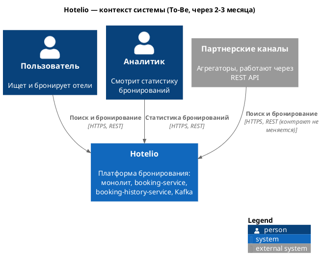
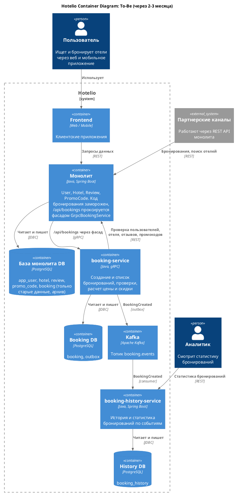
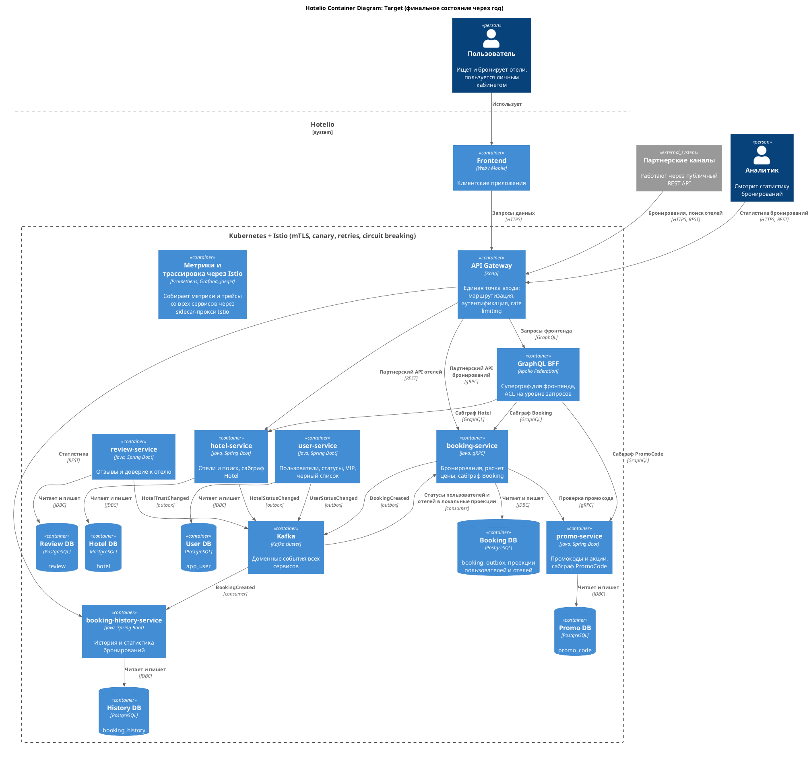

### **Название задачи:** Hotelio: переход с монолита на микросервисы (Strangler Fig)

### **Автор:** Андрей Смолин

### **Дата:** 14.11.2026

---

### **Контекст**

Hotelio — сервис бронирования отелей, около 1 млн пользователей. Всё работает в одном Java-монолите (Spring Boot) с одной базой PostgreSQL. Через REST API к нему ходят фронтенд и партнёры.

Монолит разбит на пять модулей: User, Hotel, Review, PromoCode и Booking. Вся связанность сосредоточена в Booking. При создании бронирования он проверяет пользователя и отель, считает цену и применяет промокод, то есть дёргает остальные четыре модуля. При этом от самого Booking никто не зависит.

Команда маленькая: два Java-разработчика, архитектор, фронтендер, DevOps, тестировщик и продакт. Значит, вести одновременно больше одного выноса мы не сможем.

**Что мешает сейчас:**

- Нельзя масштабировать только бронирование, хотя основная нагрузка приходится именно на него.
- Один артефакт и один релиз на всех, поэтому любая правка — это риск для всей системы.
- Аналитикам нужна статистика по бронированиям, а доступа к боевой базе им не дают.
- Фронтенду неудобно собирать данные из нескольких доменов, BFF нет.

**Что нашли в коде и учитываем при переносе:**

- `createdAt` у бронирования никогда не заполняется, поэтому статистику по дням не построить.
- Любая бизнес-ошибка (заблокированный пользователь, недоверенный отель) возвращает HTTP 500.
- Аутентификации нет: `userId` передаётся query-параметром, а `GET /api/bookings` без параметра отдаёт вообще все бронирования.

**Горизонты.** Этот ADR описывает два состояния:

- **To-Be (через 2–3 месяца)** — первый шаг, который реально успеть нашей командой.
- **Target (через год)** — финальная версия системы, к которой мы идём. В неё входят полностью микросервисная архитектура, API Gateway, GraphQL для фронтенда, Kubernetes с service mesh, Kafka-кластер, метрики и трассировка.

---

### **Функциональные требования**

| **№** | **Действующие лица или системы** | **Use Case** | **Описание** |
| :-: | :- | :- | :- |
| 1 | Пользователь / партнёр, монолит, `booking-service` | Создание бронирования | Клиент вызывает `POST /api/bookings` как раньше. Монолит через фасад передаёт запрос в `booking-service` по gRPC. Сервис проверяет пользователя и отель, считает цену с учётом VIP и промокода, сохраняет бронирование и публикует событие `BookingCreated`. Если проверка не прошла, бронирование не создаётся. |
| 2 | Пользователь / партнёр, монолит, `booking-service` | Просмотр бронирований | `GET /api/bookings?userId=...` через фасад уходит в `booking-service`. Запрос без `userId` (все бронирования сразу) больше не поддерживается, и это осознанное решение. |
| 3 | Аналитик, `booking-history-service` | Статистика бронирований | Сервис читает события `BookingCreated` из Kafka, складывает их в свою базу и отдаёт статистику по пользователям, отелям и дням. Боевые базы при этом не нагружаются. |
| 4 | Пользователь / партнёр, монолит | Отели, отзывы, пользователи, промокоды | Пока остаются в монолите без изменений. `booking-service` обращается к ним через существующий REST API. |

---

### **Нефункциональные требования**

| **№** | **Требование** |
| :-: | :- |
| 1 | Внешний REST API монолита не меняется, регресс-тесты проходят. |
| 2 | `booking-service` масштабируется независимо от монолита. |
| 3 | У каждого нового сервиса своя база, в чужие таблицы никто не ходит. |
| 4 | Переключение и откат делаются одной переменной (`BOOKING_SERVICE_EXTERNAL_HOST`) и рестартом монолита, без релиза. |
| 5 | Падение Kafka не мешает создавать бронирования. |
| 6 | Создание бронирования укладывается в p95 ≤ 500 мс. |
| 7 | Каждый сервис отдаёт health-check и метрики. |

---

### **Решение**

#### Почему начинаем с Booking

- На бронирование приходится основная нагрузка, поэтому выносить его выгоднее всего.
- От Booking никто не зависит, так что остальной монолит трогать не нужно.
- В монолите уже есть точка переключения: фасад `GrpcBookingService` и контракт `booking.proto`.
- Новые запросы бизнеса, статистика и личный кабинет, касаются именно бронирований.

Минус в том, что Booking сам зависит от четырёх модулей. Пока они живут в монолите, `booking-service` ходит в них по REST с таймаутами и circuit breaker. Позже эти вызовы заменяются локальными копиями данных, которые обновляются по событиям.

Начинать с PromoCode или Review проще, но пользы для нагрузки и бизнеса от этого почти нет. User — самый рискованный вариант: от него зависят все.

#### To-Be: через 2–3 месяца

- **Монолит** остаётся единственной точкой входа для фронтенда и партнёров. Код бронирования в нём заморожен, а `/api/bookings` фасад проксирует в новый сервис.
- **`booking-service`** забирает себе создание и список бронирований. Данные хранит в своей базе. Событие `BookingCreated` пишется в outbox в той же транзакции, что и бронирование, поэтому не теряется.
- **Kafka** работает как шина событий.
- **`booking-history-service`** собирает историю и статистику из событий. Обработка идемпотентна по `eventId`, поэтому дубли не страшны.

Бизнес-правила переносим один в один, чтобы регресс-тесты подтверждали, что поведение не изменилось. Исключение одно: заполняем `created_at`, без него не будет статистики.

API Gateway на этом этапе не ставим. Фасад в монолите уже решает задачу переключения, а партнёрам и фронтенду ничего не придётся менять.

#### Target: финальное состояние через год

Это финальная версия, к которой должна прийти система:

- Монолита больше нет. Каждый домен — это отдельный сервис со своей базой: booking, promo, hotel, review, user и booking-history.
- **Kong** — единая точка входа. Он отвечает за аутентификацию, rate limiting и отдаёт REST API для партнёров.
- **GraphQL BFF** на Apollo Federation собирает данные для фронтенда и личного кабинета из сабграфов booking, hotel и promo. Там же проверяется, что пользователь видит только свои бронирования.
- Сервисы обмениваются событиями через Kafka-кластер. `booking-service` больше не ходит синхронно к соседям, а держит у себя проекции статусов пользователей и отелей.
- Всё работает в **Kubernetes с Istio**: mTLS между сервисами, canary-релизы, ретраи и circuit breaking на уровне mesh. Развёртывание идёт через Helm и CI/CD.
- Метрики и трассировка снимаются с каждого сервиса.

#### Миграция данных бронирований

1. Копируем таблицу `booking` из монолита в новую базу с теми же `id`. Sequence стартуем с запасом, с `max(id) + 1 000 000`. Старым записям без даты ставим дату миграции и флаг `migrated`, чтобы они не попадали в статистику по дням.
2. В тихое время докопируем всё, что появилось после первого копирования, включаем фасад и рестартуем монолит. С этого момента все бронирования пишет только новый сервис.
3. Сверяем количество записей и контрольные суммы, прогоняем регресс-тесты.
4. Первую неделю новые бронирования из Kafka дописываются обратно в таблицу монолита. Так откат не потеряет данные.
5. Когда всё стабильно, таблица в монолите становится архивом, а потом удаляется вместе с кодом.

Двойную запись в обе базы не делаем: общей транзакции нет, и сразу возникает вопрос, кто из двух прав.

#### План

| Этап | Срок | Что делаем | Как откатить |
| :-: | :- | :- | :- |
| 1 | 1 нед. | Готовим окружение: отдельные базы, Kafka, health-check, разделяем регресс-тесты по доменам | — |
| 2 | 3 нед. | Пишем `booking-service`, переносим данные, гоняем тесты через фасад | Убрать переменную, рестарт монолита |
| 3 | 1 день + неделя наблюдения | Переключаем прод, замораживаем код бронирования в монолите | То же, плюс обратная синхронизация |
| 4 | 2 нед. | Outbox, события в Kafka, `booking-history-service` | Отключить публикацию, бронирование не страдает |
| **To-Be достигнуто** | | | |
| 5 | 3–6 мес. | Выносим промокоды в `promo-service`, поднимаем GraphQL BFF для личного кабинета | Вернуть вызовы в монолит |
| 6 | 6–9 мес. | Kubernetes, Helm, CI/CD, затем Istio | — |
| 7 | 9–12 мес. | Выносим Review, Hotel, User, ставим Kong, удаляем монолит | По одному сервису, как с Booking |
| **Target достигнуто** | | | |

---

### **Альтернативы**

| Альтернатива | Почему нет |
| :- | :- |
| Переписать всё разом | Долго, рискованно и не по силам команде из семи человек. |
| Модульный монолит | Не решает проблемы масштабирования и независимых релизов. |
| Начать с PromoCode / Review | Проще, но не даёт эффекта по нагрузке. PromoCode выносим следующим. |
| Сразу поставить API Gateway и маршрутизировать на нём | Фасад в монолите уже есть, а шлюз — это ещё один компонент. Кроме того, для транскодирования REST → gRPC пришлось бы менять proto и JSON-контракт. Kong появится в Target. |
| Общая база для монолита и сервиса | Сохраняет связанность, а мы как раз от неё уходим. |
| REST вместо gRPC между монолитом и сервисом | Клиент и контракт в монолите уже на gRPC. |

---

### **Недостатки, ограничения, риски**

| Риск | Что делаем |
| :- | :- |
| Бронирование стало медленнее: вместо локальных вызовов теперь несколько REST-запросов в монолит | Параллельные вызовы, кэш статусов отелей. В Target вызовы заменяем локальными проекциями. |
| Монолит упал, и бронирование тоже не работает | Таймауты и circuit breaker, понятная ошибка клиенту. |
| Потеря или дубли данных при переключении | Переключаемся в тихое время, сверяем данные, неделю держим обратную синхронизацию. |
| Прокси в закрытом jar: не настроить таймауты, `GET /api/bookings` без `userId` падает | `created_at` всегда заполнен. До переключения находим по логам, кто вызывает список без `userId`. |
| Сохраняем старые дефекты (500 на бизнес-ошибки) ради совместимости | Исправляем отдельно, после стабилизации. |
| Команде придётся освоить Kafka, gRPC и несколько баз | Выносим строго по одному сервису, используем общий шаблон сервиса. |
| Аутентификации по-прежнему нет | Закрываем в Target через Kong и ACL в BFF. |

---

### **Приложения**

- `../diagram/C1_Context_ToBe.puml` — контекст, To-Be.
- `../diagram/C2_Container_ToBe.puml` — контейнеры, To-Be (через 2–3 месяца).
- `../diagram/C2_Container_Target.puml` — контейнеры, Target (финальное состояние через год).
- `../test-log.txt` — регресс-тесты монолита до миграции.
